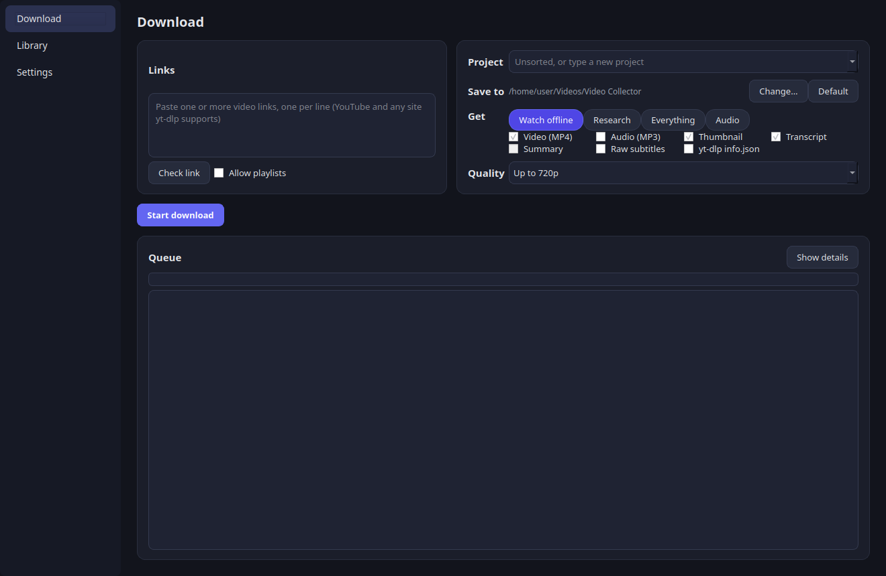
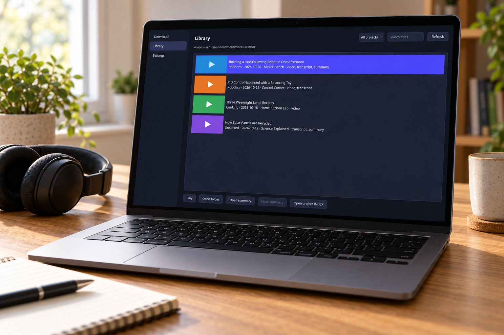
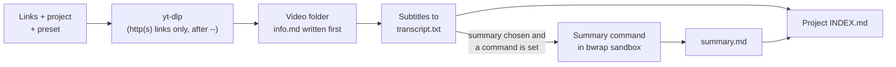
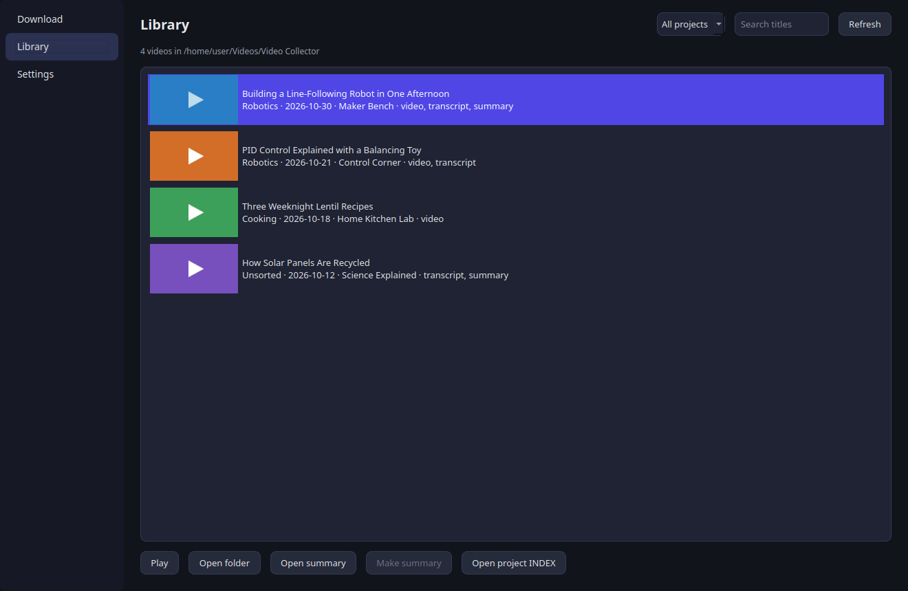
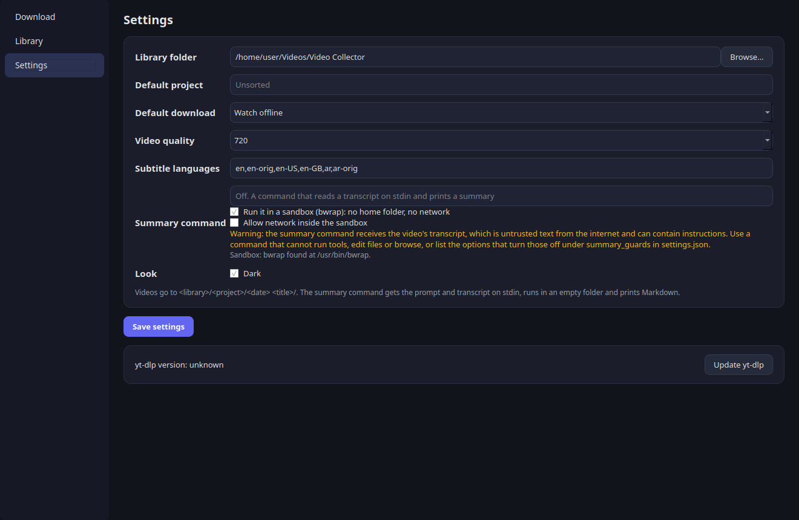

<div align="center">


# Creator Video Collector

**Download videos for offline watching and turn them into research material: a clean transcript, the thumbnail and an optional summary, in one folder per video, grouped by project.**

[](https://github.com/AbdelRahman-Madboly/video-collector/actions/workflows/ci.yml)


[How it works](#how-it-works) · [Install](#install) · [What lands on disk](#what-lands-on-disk) · [Summaries](#summaries) · [What it does not do](#what-it-does-not-do) · [Roadmap](#roadmap)



</div>

## Why Creator Video Collector

Saving a video for later is easy; keeping it findable, with its transcript and notes next to it, is
not. Creator Video Collector is a PySide6 window around [yt-dlp](https://github.com/yt-dlp/yt-dlp)
that files every download into a project library on disk, so any tool that reads files can be
pointed at a project folder.

## Highlights

- **Four download presets.** Watch offline, Research, Everything or Audio, picked per batch.
- **Clean transcripts.** Subtitles are turned into readable text in `transcript.txt`.
- **A library by project.** One folder per video with `info.md`, and a project `INDEX.md` listing
  every video, its link and the summary's first line.
- **Never overwrites.** A second download of the same link in the same project adds only what is
  missing; an edited summary is kept.
- **Bring your own summary command.** Summaries are off until you set one, and the command runs
  with a small environment, a time limit and, by default, inside a `bwrap` sandbox with no network.
- **Check before you download.** **Check link** shows the title, channel, length, subtitles and the
  real qualities of a single link.



<sub>Concept image of the app on a laptop. The screen shows a real screenshot from demo data.</sub>

## How it works



`info.md` is written before the download, so a failed download still leaves a readable folder. A
summary failure keeps the download and is noted in `info.md`.

## Screenshots

| Library | Settings |
|---|---|
|  |  |

<sub>Made-up example videos.</sub>

## Status

2.0.0 plus unreleased changes (see [CHANGELOG.md](CHANGELOG.md)). All tests pass and run in CI; a first
check on a few real videos is still open.

## Install

Needs Python 3.12+, [uv](https://docs.astral.sh/uv/), `yt-dlp` and `ffmpeg`, and `bwrap` for sandboxed
summaries.

```sh
sudo apt install ffmpeg bubblewrap
./install_youtube_visual_collector.sh       # uv environment, launcher, menu entry
```

## Run

```sh
youtube-visual-collector                    # after installing
uv run python youtube_visual_collector.py   # straight from the folder
```

## Usage

Open **Creator Video Collector** from the desktop or the app menu (`youtube-visual-collector` in a terminal).

- **Download:** paste one or more links (one per line), pick or type a **project**, choose what to get, press
  **Start download**. **Check link** shows the title, channel, length, subtitles and the real qualities of a
  single link. **Change…** saves this batch somewhere else; **Default** goes back to the library.
  - Watch offline: video, thumbnail, transcript
  - Research: thumbnail, transcript, summary (no video file)
  - Everything: video, thumbnail, transcript, summary, raw subtitles, info.json
  - Audio: MP3, thumbnail, transcript
- **Library:** every video by project with its thumbnail; play it, open its folder or summary, make a summary
  later, or open the project's `INDEX.md`.
- **Settings:** library folder (default `~/Videos/Video Collector`), default project and download, quality,
  subtitle languages, the summary command, light or dark, and **Update yt-dlp**.

### What lands on disk

```
~/Videos/Video Collector/<Project>/
  INDEX.md                         every video of the project, its link and the summary's first line
  2026-10-27 <Title>/
    video.mp4 | audio.mp3          when chosen
    thumbnail.jpg
    transcript.txt                 clean text from the subtitles
    summary.md                     TL;DR, key points, details for R&D, open questions
    info.md                        title, channel, link, length, dates, project, transcript and summary state
    raw/                           original subtitles and yt-dlp info.json (Everything)
```

Any tool that reads files can be pointed at a project folder. A second download of the same link in the
same project adds only what is missing and never overwrites a file (an edited summary is kept).

## Summaries

Summaries are off until you set **Summary command** in Settings. The summary command is any command that
reads a transcript on stdin and prints a summary on stdout, for example a language model's command-line
tool. The collector sends it a prompt that asks for four Markdown sections, followed by the transcript.

> [!WARNING]
> The transcript is untrusted text from the internet and can contain instructions aimed at
> the tool that reads it. Use a command that cannot run tools, edit files or browse, or make sure those
> features are turned off.

Long transcripts are summarized in parts, then together. A failure keeps the download and is noted in
`info.md`.

<details>
<summary>How the collector limits the summary command</summary>

- The prompt and transcript go to the command on stdin only, never as an argument.
- The command line is split like a shell line, but no shell runs it.
- It runs in an empty temporary folder, with a 10 minute limit, and with a small environment: `PATH`,
  `HOME`, user, locale and XDG folder variables only. Add other variable names (for example the one that
  holds an API key) to `summary_env` in `settings.json`.
- With **Run it in a sandbox** on (the default) the command runs inside `bwrap` (bubblewrap,
  `sudo apt install bubblewrap`): only the system folders (`/usr`, `/etc`, `/lib`, `/bin`, ...) are
  visible and read-only; `/tmp`, `/run` and your home folder are empty and private; the job's empty
  folder is the only writable place; there is no network. If `bwrap` is missing, summaries fail instead
  of running unconfined; Settings shows whether it was found. Turn the sandbox off only for a command you
  trust with your files.
- A tool that needs its own config or login files can read them only when you list those paths in
  `summary_readonly` in `settings.json`, for example `"summary_readonly": ["~/.config/my-assistant"]`.
  Tick **Allow network inside the sandbox** for a tool that has to reach an online service.
- `summary_guards` in `settings.json` maps a program name to the option groups it must always get. The
  collector adds any group that is missing from the command, so a tool that can use tools never runs
  without the options that turn them off:

  ```json
  "summary_guards": {"my-assistant": ["--no-tools", "--sandbox read-only"]}
  ```

</details>

## What it does not do

- No speech-to-text: a video without subtitles gets no transcript and no summary.
- It does not write summaries by itself: you bring the summary command.
- It cannot recognise every tool that can act on what it reads: the guards are the ones you list.
- Downloads saved to a one-off folder (**Change…**) do not show on the Library page, which reads the
  library folder from Settings.
- It does not update yt-dlp by itself; press **Update yt-dlp** in Settings when sites start failing.
- No cookies or logins: private or age-restricted videos fail with the yt-dlp error.
- Linux only (tested on Ubuntu).

## Roadmap

- [ ] First check on a few real videos

## Develop

```sh
uv run python -m pytest -q                  # tests never touch the network, yt-dlp or a summary command
```

Only http(s) links reach yt-dlp, always after `--`. See [docs/ARCHITECTURE.md](docs/ARCHITECTURE.md) for
the modules.

## Layout

| Path | What it is |
|---|---|
| `src/creator_video_collector/` | The app package: downloader, jobs, library, subtitles, summarize, settings, `ui/` |
| `youtube_visual_collector.py` | Launcher for running straight from the folder |
| `install_youtube_visual_collector.sh` | uv environment, launcher and menu entry |
| `tests/` | pytest suite |
| [`docs/ARCHITECTURE.md`](docs/ARCHITECTURE.md) | Module layout |
| [`docs/design/`](docs/design/) | Design notes and plan |

## License

MIT, see [LICENSE](LICENSE).

## Author

Designed and built by **Abdel Rahman Mohamad EL-Sayed** ([@AbdelRahman-Madboly](https://github.com/AbdelRahman-Madboly)).
